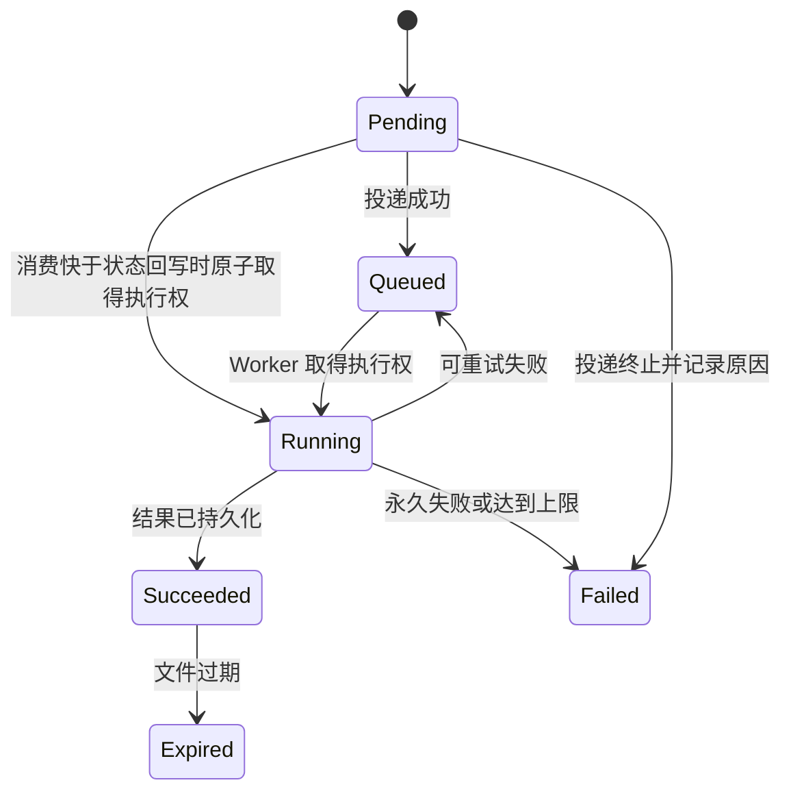
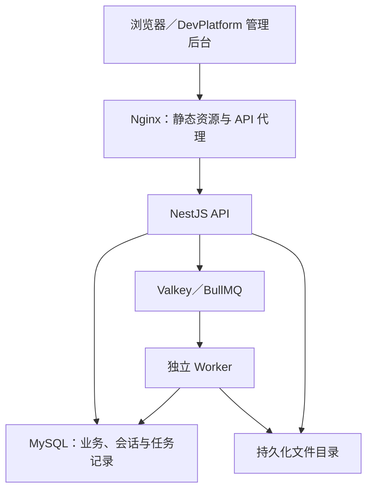

# DevPlatform 产品需求与技术实施方案

**文档版本：V1.0（最终版）**  
**编制日期：2026-11-10**  
**品牌：BaJie Dev｜八戒开发**  
**工程名称：DevPlatform**  
**主仓库：`dev-platform`**  
**项目名称：BaJie Dev 软件产品开发与定制交付平台建设项目**  
**适用范围：产品规划、开发实施、测试验收及独立部署交付。**

本文定义产品与工程实施基线。V1.0 为文档版本；软件发布版本及各项能力以实际交付和验收结果为准。

## 目录

1. 产品定位与交付模式
2. 建设目标与功能范围
3. 后台页面与交互规范
4. 身份认证与权限管理
5. 基础配置与系统审计
6. 文件管理
7. Excel 导入
8. 任务中心与异步导出
9. 数据模型与数据约定
10. 技术选型与依赖基线
11. 系统架构与代码组织
12. API 契约与前端接入
13. CRUD 代码生成器
14. 版本管理与客户升级
15. 部署、备份与项目交付
16. 非功能要求
17. 实施路线与研发流程
18. 验收标准
19. 投入估算与持续维护
20. 默认参数与实施约束
21. 参考资料

## 一、产品定位与交付模式

### 1.1 产品概述

BaJie Dev｜八戒开发面向需要独立部署的业务系统，提供行业软件产品、定制开发、部署实施和维护服务。开发侧建设可复用的软件底座，客户侧获得符合业务流程的软件系统。平台统一采用 Vue3＋TypeScript＋Node.js 技术路线，每个客户独立部署应用、数据库、文件与配置。

### 1.2 建设背景

项目由独立开发者利用日常工作间隙推进，优先建设基础服务与管理后台，形成可运行、可复用、可维护、可独立交付的软件底座。后续基于底座开发行业软件，提供成熟产品销售、部署实施、二次开发和维护服务。

品牌范围覆盖后台、后端以及未来的 App、小程序、PDA 等应用；首个软件版本只交付 PC 管理后台和通用后端能力，不因此承诺已经提供多端客户端。

### 1.3 建设原则

1. 先完成真实业务链路，再扩展公共能力；重复出现的需求经验证后沉淀为通用模块。
2. 使用模块化单体，优先复用成熟组件，控制单人开发和维护成本。
3. 核心能力、行业规则与客户定制保持边界，升级来源和变更可以追溯。
4. 所有访问控制由后端执行，已启用功能必须满足数据一致性、安全和恢复要求。
5. 文档版本与软件版本独立；功能实现、性能和恢复能力以实际验收结果为准。

### 1.4 技术与工程决策

| 编号 | 决策 | 对实施的约束 |
|---|---|---|
| D01 | 品牌为 BaJie Dev，工程仓库不带 bajie | 主仓库使用 dev-platform |
| D02 | 自主建设统一底座，参考成熟开源项目 | 维护自有接口、数据模型和版本；记录复用来源及许可 |
| D03 | 前端采用 管理后台基于 Vben Admin v5.7.0、Element Plus | 固定来源提交，保留必要 @vben/* 包 |
| D04 | 采用 NestJS、TypeORM、MySQL 8.4 LTS 技术方向 | 精确版本及集成方式以兼容性验证结果锁定 |
| D05 | 异步能力采用 BullMQ＋Valkey | 完成异步导出阶段接入，不作为最小登录链路前提 |
| D06 | Docker Compose＋Nginx 独立部署 | 每客户独立应用、配置、数据库与文件空间 |
| D07 | 先基础闭环，再业务定制 | 不以完成 PDA 全部业务作为底座发布前提 |
| D08 | 当前不经营框架、会员及插件市场 | 不建设交易、会员授权或第三方插件执行平台 |

### 1.5 用户与职责

| 对象 | 使用内容 | 权限边界 |
|---|---|---|
| 平台维护者／开发者 | 源码、开发脚本、生成器、发布和部署工具 | 开发工具在开发环境运行，不等于拥有所有客户生产数据权限 |
| 客户管理员 | 客户实例的账号、角色、菜单及允许开放的配置 | 仅管理当前实例；不能通过后台执行 SQL 或任意服务器命令 |
| 客户业务用户 | 按授权使用业务模块 | 所有数据访问由后端鉴权 |
| 演示访问者 | 独立演示实例与虚构数据 | 不接触正式客户环境 |

不建设中央客户控制台。维护者访问客户环境，按实际服务约定授权。

### 1.6 产品资产分层

| 层级 | 示例 | 拥有什么 | 成熟标准 |
|---|---|---|---|
| 公共底座 | dev-platform | 工程、基础后台、通用服务、交付脚本 | 独立部署、第二实例、升级恢复验证通过 |
| 行业产品 | product-qc（名称示例，未立项） | 商品、检品、装柜等完整行业流程与规则 | 真实业务闭环、操作手册、产品验收、可演示 |
| 客户项目 | client-c001-qc（名称示例） | 品牌、业务参数、专属流程和集成 | 按合同范围独立验收、交付与维护 |

底座自身不包含“任何行业都通用”的订单、库存、支付或设备模型。行业产品拥有独立需求文档和版本。没有完整行业流程，仅有账号和表格页面时，不对外称为成熟行业系统。

复用升级来源为底座→行业产品→客户项目；没有行业产品层的定制业务可直接底座→客户项目。同一客户选择一条主升级来源，不同时无序合并底座和行业产品两条来源。公共修复经脱敏与权利检查回到相应上层；客户数据、私有接口密钥、专有流程不回流。

### 1.7 首个业务验证范围

优先选择“PC 后台＋结构化数据＋账号权限＋导入导出＋独立交付”的小型系统。首个验证模块建议采用简化设备台账：编号、名称、状态、归属部门、备注和附件；用于覆盖平台能力，默认不承诺作为行业成品出售。

PDA 检品系统可作为候选行业试点，但不能直接把其离线同步、扫码、混装包装规则划入底座。若选择 PDA 为首项目，需在项目层补齐离线身份、设备绑定、冲突处理、幂等上传和同步版本；普通 Web 会话设计不自动适用于 8 小时离线作业。

## 二、建设目标与功能范围

### 2.1 建设成功标准

| 目标 | 验证方法 | 通过标准 |
|---|---|---|
| 基础闭环 | 空环境安装到实际操作 | 初始化、登录、授权、读写、审计、部署通过 |
| 可复用 | 用同一底座建立第二个实例 | 无需修改核心源码即可独立配置和运行 |
| 可定制 | 增加一个验证业务模块 | 通过约定服务接口扩展，不复制另一套认证权限体系 |
| 可交付 | 按交付文档部署与恢复 | 在干净验证环境独立完成，记录步骤及结果 |
| 可升级 | 从一个已发布测试版本升级 | 保留原数据及定制模块，失败路径经过演练 |
| 有效率依据 | 记录首模块、第二模块及第二实例投入 | 形成真实耗时与问题记录，暂不承诺节省比例 |

### 2.2 功能优先级与软件版本

P0＝基础底座软件 v1.0.0 必交；P1＝后续软件 v1.1 候选；P2＝按真实需求评估。后文涉及 P1 时不纳入 v1.0.0 验收。

| 能力 | 优先级 | 软件发布归属 | 边界 |
|---|---|---|---|
| 工程、配置、数据库迁移、健康检查 | P0 | v1.0.0 | 本地及独立服务器部署 |
| 认证、会话、用户、角色、菜单、接口权限 | P0 | v1.0.0 | 本实例账号；无公网自行注册 |
| 部门和基础数据范围 | P0 | v1.0.0 | 单部门归属，复杂多组织后置 |
| 字典、公开参数、登录及操作审计 | P0 | v1.0.0 | 密钥不进入公开参数 |
| 文件、本地存储、Excel 导入 | P0 | v1.0.0 | 明确限制，受控模板 |
| 异步导出、任务查询与恢复 | P0 | v1.0.0 | Worker＋BullMQ＋Valkey |
| 验证业务模块 | P0 | v1.0.0 | 验证能力，不作为商业成品 |
| 项目初始化、版本清单、部署、备份恢复 | P0 | v1.0.0 | 脚本与文档，不做可视化运维平台 |
| 标准单表 CRUD 生成器 | P1 | v1.1 候选 | 全部生成闭环统一交付，见“CRUD 代码生成器” |
| 站内通知、统计展示公共组件 | P1 | v1.1 候选 | 有重复需求再提炼，非通用统计引擎 |
| S3 存储、复杂联动、关联表生成 | P2 | 未定 | 单独确定范围 |

### 2.3 范围边界

首期不建设以下能力：多租户 SaaS、动态插件市场、会员收费系统、拖拽页面设计器、通用审批引擎、微服务治理、Kubernetes、在线数据库编辑器、在线自动升级中心、完整移动端客户端。

在线建表、运行时字段修改与复杂字段联动不属于首版交付项。软件底座发布不依赖客户项目成交；商业价值需另行验证。

### 2.4 核心用户故事

| 编号 | 用户与目标 | 验收重点 |
|---|---|---|
| US01 | 维护者从固定版本创建新项目 | 不改认证核心即可部署第二实例，数据与密钥隔离 |
| US02 | 超级管理员分配查看与修改权限 | 全量查看＋本人修改能分别生效，API 直接调用同样受限 |
| US03 | 业务人员维护台账和附件 | 保存冲突明确、越权拒绝、附件不因猜 ID 泄漏 |
| US04 | 管理员批量导入资料 | 预检错误定位、确认重复不重复写、发生冲突整批失败 |
| US05 | 业务人员发起清单导出 | 可离页查询；撤权后文件不可下载；失败原因可理解 |
| US06 | 维护者发布修复并升级客户 | 来源可追溯、定制保留、迁移冲突可发现、恢复有证据 |

### 2.5 价值验证

| 阶段 | 动作 | 证据 | 继续／调整条件 |
|---|---|---|---|
| 方案验证 | 复盘 2—3 份真实需求或历史交付记录；有条件访问客户 | 重复页面、规则、耗时和痛点清单 | 两个场景存在真实重合再提炼；无数据则只保留必要基础能力 |
| M0 后 | 运行真实登录和业务读写 | 构建、接口、迁移报告及实际工时 | 适配成本显著超估则缩小工程改造，不继续堆模块 |
| 首项目后 | 记录平台开发、业务开发、返工、部署及售后 | 分项工时、缺陷、客户验收 | 若业务闭环仍无法交付，暂停新增通用能力 |
| 第二项目后 | 同口径比较初始化及重复模块投入 | 第二次使用的差异记录 | 无节省且维护负担增加，减少抽象或采用成熟组件替代 |

不要求先完成大样本访谈才允许做本人的开发工具；对外成品定位、售价和增长计划则必须有客户证据。没有可信样本时不编造 TAM、销量、ROI、趋势预测准确率。

### 2.6 复用收益计量

建议记录四类工时：平台建设、客户业务、交付实施、维护修复。项目贡献＝实收收入－外购服务－第三方费用－其他直接现金成本；经济收益还需减去投入工时×个人机会成本。含税报价、税费和收款安排由具体交易确定，本方案不提供税务结论。

复用收益按相同模块、相近复杂度、同口径比较；建议试验目标为第二次实例初始化≤4 小时、第二个同类标准模块比首模块减少至少 20% 人工投入。两者都是内部验证目标，尚无基线。若业务差异太大，不进行误导性的百分比比较。

## 三、后台页面与交互规范

### 3.1 信息架构

| 一级入口 | 页面 | 核心内容 | 阶段 |
|---|---|---|---|
| 工作台 | 概览 | 当前用户、版本、授权入口、本人最近任务；不展示虚构业务 KPI | Alpha |
| 系统管理 | 用户、角色、菜单、部门 | 账号状态、功能授权、逐操作范围、导航配置 | Alpha 基础；Beta 完整范围 |
| 基础配置 | 字典、公开参数 | 受控配置，展示生效方式 | Beta |
| 审计记录 | 登录记录、操作审计 | 筛选、详情、requestId、安全脱敏 | Alpha 先必要查询 |
| 任务中心 | 导入批次、导出任务 | 本人任务、状态、结果、受控重试及到期时间 | Beta |
| 验证模块 | 设备台账 | 列表、表单、附件、导入导出、范围校验 | Alpha 手工 CRUD；Beta 完整 |
| 个人中心 | 资料、改密、当前会话 | 本人操作与会话撤销 | Alpha |

不把服务器 Shell、数据库连接密码、生产在线建表和代码执行器放到客户后台。维护状态通过受限状态接口或运维脚本查看；现阶段无需再建设独立客户运维平台。

### 3.2 通用列表与表单

列表保留筛选、重置、分页、固定排序与权限按钮；操作完成后保持合理筛选条件。新增／编辑采用常规抽屉或对话框，固定字段级校验与提交反馈。删除展示对象信息和影响，引用约束失败保持页面并提示处理路径。

编辑表单携带 version；409 时保留用户未提交内容，提供重新加载或复制内容的动作，禁止默默用旧内容覆盖。保存超时进入“结果待确认”，以请求标识或业务查询恢复状态。无权字段不只置灰，响应 DTO 不返回敏感字段，服务端拒绝越权修改。

批量选择明确“仅当前选中记录”，筛选变化后清理失效选择；首版不默认支持跨全部分页全选。附件上传完成不意味着业务已保存，取消表单留下临时附件由后台回收。

视觉采用 Vben／Element Plus：先保证表格、表单、反馈、键盘操作与页面一致性；品牌名称、Logo 和主色配置化。主题使用框架现有能力，首期重点统一表格、表单、反馈与品牌样式。多语言保留现有基础结构，自有文案中文优先，不声称已完成所有业务语言。

## 四、身份认证与权限管理

### 4.1 初始化与会话操作

| 操作 | 正常行为 | 异常与限制 |
|---|---|---|
| 初始化管理员 | 一次性部署命令读取安全输入并创建 | 已初始化则拒绝再次建初始管理员；并发以事务／唯一约束保护；无公开初始化接口 |
| 登录 | 校验账号、密码、启用状态，创建会话并签发短期 Access Token | 错误不暴露账号是否存在；按账号及来源限流；故障与密码错误分开记录 |
| 请求认证 | 校验签名、有效期、会话未撤销、用户启用及安全版本 | 会话校验依赖故障返回 503，不放行；前端不因此反复清除账号 |
| 续期 | 原子替换 Refresh Token 哈希，返回新凭证 | 已撤销、过期或复用按确定策略拒绝；并发续期受控 |
| 退出 | 撤销当前会话、清理 Cookie 和本地状态 | 重复退出幂等；不必知道 Refresh Token 才能撤销已识别会话 |
| 禁用／重置密码 | 撤销目标用户已有会话 | 已完成请求不倒退；撤销提交后开始的新请求必须拒绝 |

Access Token 存于前端内存，Refresh Token 通过同源安全 Cookie 传输，服务端仅保存哈希。前端统一续期入口，同一上下文并发请求合并刷新，多标签页协调处理；具体凭证、轮换和安全规则见下一节。

### 4.2 凭证、刷新与幂等

采用短期 Access＋HttpOnly Refresh 设计。Access 载荷至少有 sub、sid、iat、exp、iss、aud；验证明确算法和签发方，禁止由 Token 自行决定可接受算法。session 保存当前刷新哈希、轮换代次、绝对到期和撤销原因。建议 Refresh 的 7 天先采用绝对有效期，轮换不无期限顺延。

刷新在事务中按会话锁定，比较当前哈希后替换。采用严格复用策略：旧凭证再次使用即撤销当前会话并重新登录；不把无原因的重复刷新解释成成功。前端同标签 single-flight、多标签锁与通知减少合法竞争；浏览器不支持协调机制时允许安全地重新登录。网络断开导致刷新响应丢失时也重新登录，明确接受体验代价，不引入尚未设计的宽限重放缓存。

生产刷新 Cookie 使用 Secure、HttpOnly、明确 SameSite 与 Path；清除使用同一配置。对 Cookie 参与认证的修改接口统一做 CSRF／Origin 防护；主业务 Bearer Access 不因存在 Cookie 自动放行。Access 只在内存，页面重载通过一次受控刷新恢复。首次管理员和重置密码用户进入强制改密流程，仅开放本人改密、退出及必要身份接口；改密成功后建立新会话。

幂等作用域必须包含用户、实例、接口与规范化请求摘要。同键同摘要返回原结果；同键不同摘要返回 409。确认提交的批次还需事务状态锁。临时幂等记录清理后仍要依赖批次终态和业务唯一键防重复；有外部副作用的未来业务不能直接用短期幂等表推断永久安全。

### 4.3 用户与角色

用户支持列表、查询、创建、编辑、禁用、角色分配、密码修改／重置、会话查看与撤销。账号标准化后唯一；首版建议账号永久不复用，停用代替日常删除。密码哈希绝不返回前端。

角色编码唯一；已关联用户的角色不直接删除，先解除引用。禁止禁用、删除或解除最后一个有效超级管理员；校验与变更在并发受控事务中完成。普通管理员不得授予自己没有的权限、管理更高权限账号或通过改角色绕过限制。首版进一步限制为仅超级管理员可分配角色及操作权限，普通管理员不具备授权入口与 API 权限；详见“管理员授权边界”。

建议多角色功能权限取并集，数据范围仅在实际授予该操作的角色中合并。数据结构采用“身份认证与权限管理”中的角色—操作权限—数据范围关联，不能仅用一个角色级范围代替。首版不引入显式拒绝优先级；若后续需要，单独扩展策略。超级管理员能力必须显式定义和审计，角色身份从服务端认证上下文获取。

### 4.4 管理员授权边界

首版建议采用明确的二级管理规则：超级管理员管理角色授权、管理员账号和系统安全；普通管理人员可在获授范围内管理业务与普通账号，不能分配角色或创建管理员。若要让普通管理员授权角色，必须另做可委派角色白名单与范围上界校验，本版不隐含支持任意委派。

所有影响超级管理员资格的操作，先锁定 sys_security_state 的固定行，再在同一事务内验证操作后仍存在有效超级管理员，更新授权并审计。只对“当前查到的管理员行”加锁不足以完整表达并发不变量。CLI 紧急恢复也记录恢复原因和审计，不提供公网恢复入口。

### 4.5 操作权限与菜单

API 操作权限由代码中的权限声明注册表定义，例如 system:user:list、system:user:assign-role、demo:record:export。发布时通过受控命令同步 sys_permission，校验编码唯一和权限引用完整性。后台只能分配当前已发布且可授予的权限，不能靠新增菜单动态创造可执行 API 权限。

sys_menu 管理导航和组件映射；sys_role_menu 表示导航分配；sys_role_permission 表示真正操作授权。页面只有在导航获分配且具备声明的进入权限时展示。按钮是否显示取决于相应操作权限。隐藏菜单不撤销 API 权限；停用页面仅影响页面准入，如需停用业务能力，应通过显式权限停用或模块停用，同时作用于 API、Worker 与下载。避免“禁用一个菜单到底是否撤权”的歧义。

首版 UI 可提供“同时分配页面必需权限”的明确勾选操作，但后台展开具体权限差异并审计；不把父菜单勾选隐式解释为无限操作授权。

### 4.6 菜单结构与接口约束

菜单类型：目录、页面、按钮、外链；字段：编码、父节点、路由名、路径、组件标识、标题、图标、排序、显示和启用状态。建议最大 5 层，禁止循环、自身为父、重复路由名和冲突路径；存在子节点或角色引用时禁止直接删除。

后端返回当前账号菜单和权限码，Vben 使用后端动态菜单模式。组件标识只映射构建时已知页面白名单；外链限制协议，不允许脚本 URL。隐藏仅影响展示；菜单停用影响页面准入，操作权限及模块停用才影响相应 API 授权，详见“操作权限与菜单”。

API 权限标识使用 system:user:list 等稳定编码；角色授权后端验证。业务接口默认受保护，公开健康接口和登录接口显式声明。无权限、未登录、资源不存在分别返回对应错误；受限对象可用统一 404 隐藏存在性，所有同类接口保持一致。

权限修改提交后，后续请求使用新权限；首版可每次从数据库读取会话与有效权限，不依赖难以失效的长期缓存。页面可在下次请求时更新菜单，不能因菜单暂未更新而放行 API。

### 4.7 数据权限规则

支持全部、本部门、本部门及下级、指定部门、本人。用户首版仅一个所属部门，指定部门为角色授权关联；无部门用户不获得部门范围。树移动检查循环；存在子部门、用户或业务归属时禁止直接删除。

业务模块必须声明归属字段及适用操作，不自动假设所有表都有 dept_id。建议验证模块“本人”以 created_by 判断，部门以 owner_dept_id 判断；负责人逻辑由未来业务显式声明。

列表、详情、修改、删除、统计、批量操作、导出及远程选项都执行同一范围检查；批量包含无权数据时整批拒绝，不静默跳过。新建／转移归属也必须检查目标范围。无归属数据默认仅授权管理员可见。

部门调整不自动迁移历史记录归属。历史数据归属、跨部门负责人、多个归属字段等实际业务口径需客户项目单独确认。验证模块必须覆盖这些规则的否定用例。

### 4.8 数据范围与并发写入

列表和总数必须共享同一范围谓词，详情、统计、远程选项也使用它。更新使用范围与版本共同约束，禁止先查可见后只按主键更新。

```sql
-- 方案示意；授权谓词由可信后端策略生成，所有值使用绑定参数。
UPDATE demo_record
SET name = :name, version = version + 1, updated_at = :now
WHERE id = :id
  AND version = :expectedVersion
  AND deleted_at IS NULL
  AND (/* 对当前操作有效的数据范围 */);
```

受影响行数为 0 时，通过受限查询判断可见对象是否发生冲突；对不可见或不存在统一 404，可见且版本已变化返回 409。业务更新、成功审计、幂等结果在同一数据库事务中完成，使用同一个事务 EntityManager。不得部分使用全局 Repository 导致事务外写入。

批量操作对去重后的 ID 集合检查完整性，在事务中按稳定顺序锁定目标或使用足以保持约束的条件写入。任一不可见、已删除、版本冲突则整批回滚；不能以“查到几条就修改几条”实现。若业务要求授权变更提交后所有尚未落库的写入都被撤销，需增加共享安全锁等更强串行策略；首版基线只保证授权变更提交后开始的新请求使用新权限，并对敏感完成操作再次校验。

### 4.9 授权变更与撤权

以下变更与 authz_epoch 递增同事务：角色权限及范围、用户角色、用户部门或启用状态、部门树移动、影响范围的业务归属转移、业务模块授权启停。首版全局代次会让无关用户的已有导出也失效，接受这个简化代价；大量导出后再评估用户／资源粒度版本。

请求从数据库获取当前用户与权限，不信任 JWT 内持久角色快照。导出开始记录 epoch，完成提交前再次读取并比对，下载时再比对；不一致则不发布／不下载并提示重新导出。完成事务与授权事务对安全状态行采用一致锁顺序，防止“检查通过后授权已变、仍提交旧文件”的竞争。下载只保证下载授权判断时的权限，已传到客户端的字节不可收回。

文件下载不是简单比较上传者：临时文件归上传者；业务附件按当前有效关联对象权限；导出文件按任务归属、功能权限及授权代次。三者分开实现。

## 五、基础配置与系统审计

### 5.1 字典和参数

字典类型编码、类型内项值唯一；被引用的项值不可直接修改，停用后禁止新选，历史记录仍展示原值及停用提示。不存在的项以原值回显，不能让详情页崩溃。业务状态转换不依赖用户任意编辑字典来决定。

公开配置按平台、模块分组，定义类型、范围、可修改角色和生效方式。首版参数仅限白名单公开项，更新后下一次读取生效。密钥、数据库密码、签名配置来自受控环境配置，不以 VITE_* 变量或前端可读接口下发。

### 5.2 日志与业务审计

登录日志、业务审计、运行日志、任务日志分开。审计记录操作者快照、对象、动作、结果、UTC 时间、requestId；必要差异按字段白名单记录，不存完整请求体。密码、Token、Cookie、密钥、导入原始敏感行不进入日志。

建议数据库业务变更与成功审计同事务提交；失败尝试记录独立安全／运行事件。审计写入失败则该受审计变更回滚并返回错误，不能返回成功。日志查询有专门权限，普通管理员不能编辑审计记录。

日志保存周期、脱敏范围和备份周期为参数；达到容量告警先清理可清理日志，不擅自清理业务数据。

## 六、文件管理

### 6.1 上传、关联与下载

上传接口校验角色、大小、扩展名及实际内容；采用随机存储名并防路径穿越。业务仅保存 file_id，物理路径不返回；目录不直接作为公开静态目录。HTML／SVG 等可能执行内容默认不开放内联展示。

sys_file 保存元数据，sys_file_link 保存业务对象关联。临时文件仅上传者可访问；关联后依据业务对象授权。下载时必须至少存在一条当前用户有权访问且允许下载的有效业务关联；无可访问关联一律拒绝。对机密文件或带多个对象信息的复合文件采用模块显式的更严格策略，禁止用“有任意引用”代替授权。

上传成功但业务保存失败的文件保持临时状态，清理任务按有效期处理。存在引用时禁止直接物理删除；解除最后引用后进入待清理。物理清理失败保留状态与原因并重试，不能先丢元数据。磁盘不足、文件缺失返回明确错误并告警。

### 6.2 清理与存储一致性

业务引用创建和文件状态变更共用事务；存储写入不能参与 MySQL 事务，用临时态、待清理态和对账补偿。清理按不可变 storage_key，先原子认领再删除，失败留元数据重试；存在有效引用时拒绝业务侧直接删除。

## 七、Excel 导入

### 7.1 导入能力与事务规则

首版提供受控 xlsx 模板及“新增导入”，更新／新增或更新后置，避免没有业务匹配键就实现通用覆盖。每个模块定义模板版本、字段、类型、唯一键、字典及归属校验。

流程：上传临时文件→解析预检→返回校验结果与批次 ID→用户确认→再次授权及关键约束校验→事务写入→保存结果。空文件、模板不匹配、超限及任一错误行均阻止整批提交。

建议首版在明确规模上限内整批事务，不部分成功。预检不锁定实时数据库；确认时再次检查重复与引用，冲突则整批失败并提示重新预检。文件内重复、库内重复分别报告，错误报告下载执行权限校验。

确认接口使用幂等键及批次状态锁。重复确认返回同一批次结果；网络超时提示查询批次状态，不直接再次写入。成功数是实际提交行数，失败批次成功数为 0；错误行数与错误条数分开。

### 7.2 解析隔离、批次状态与确认

首版只有受控 xlsx 新增导入。建议不超过 1,000 行、10 MiB，并另设解压后体积、工作表数、单元格数、单元格文本长度与解析超时限制，防止压缩包体积小而解压耗尽资源。禁止公式／宏及外部引用输入；是否允许空格标准化按字段定义，条码不能擅自转数值。

受限解析仍应放到独立进程或 worker thread，避免占用 API 事件循环；Alpha 不开放导入，Beta 若开放必须已有隔离解析。队列框架并不自动消除 CPU 阻塞，要验证实际处理器运行模型。

流程状态：Uploaded → Checking → Invalid／Ready → Committing → Committed；Committing 是带批次行锁的提交事务内状态，事务未提交而进程退出时回滚到原状态，不留下永久处理中；Ready 可超时 Expired，提交事务失败回到可明确识别的 Failed，需重新预检后再确认。Ready 只表示预检当时通过。确认必须校验文件哈希、模板版本、批次所属人、有效期和权限，并再次核查唯一键与关联数据。

首版预检结果表只显示前 100 条错误供浏览，并提供完整错误报告；整批有错误就禁止提交。错误信息写行号和字段，不在普通日志复制原始敏感行。预检输入不可由前端以一份“已校验行数组”替换。

## 八、任务中心与异步导出

### 8.1 任务状态与可靠投递

MySQL 中创建 sys_task 和 sys_task_dispatch，同一事务提交；投递器扫描未投递记录，将 task_id 与 dispatch_generation 组合为稳定 job 标识投递，同一投递代次重试不改变标识。入队失败保留待投递并有限重试／告警。即使队列任务已清除，Worker 仍以任务表检查是否已经完成。



投递状态与任务状态分别管理；队列与数据库短暂不一致由对账恢复，不把“入队成功”当成业务成功。Worker 以原子认领、租约／心跳和执行代次防止旧执行覆盖新结果；异常终止后按超时及重试策略恢复。临时输出完成后原子发布，再以执行代次提交结果；失败遗留由清理任务处理。

首版只把无外部副作用的导出纳入任务闭环。未来支付、设备指令等不能直接套用导出重试策略。幂等实现和 MySQL／队列一致性必须有故障注入验证。

### 8.2 执行顺序与竞争处理

1. API 在一个事务内写 task、dispatch 和幂等结果，返回 202 及 taskId；接受不等于开始执行。
2. 投递器认领待投递记录，提交队列 job。若先消费后回写，Worker 允许从 Pending／Queued 原子取得执行权；投递器只能条件更新，不得把 Running 覆盖为 Queued。
3. Worker 检查任务类型、handler_version、用户状态、当前权限；以条件更新取得新的 lease_token 与 attempt_no。重复投递但已有有效租约则不执行。
4. Worker 分批读数据并定期检查续租及授权代次；心跳更新必须带 lease_token。长期读任务按稳定排序和 keyset 游标推进，避免大 offset。
5. 临时文件名包含 taskId、attempt_no 和随机后缀。输出采用唯一不可变存储键，不让多个执行写同一最终路径。
6. 文件完成后，以任务行锁、安全状态锁、当前 lease_token 与 epoch 校验共同完成结果元数据和 Succeeded 提交。失去租约的旧执行只能清理自己的产物，不能覆盖新结果。
7. 队列完成回调不改变已完成业务结果。数据库成功而队列确认失败时，再消费只识别终态；文件成功而数据库失败时保留短期产物供受控恢复或清理，不返回成功下载。
8. 对账扫描过期租约、未投递、缺失队列记录和孤儿输出。告警及重试均有上限；鉴权失败、模板错误和超限不自动重试。

这提供至少一次投递下的受控重复执行，不承诺队列 exactly-once。导出重读可接受，支付扣款和设备控制须有自身业务幂等与确认协议。

### 8.3 导出与下载

建议执行时重新校验发起用户和权限，按当时有效范围取数；排队期间撤权或禁用则失败，不导出。执行过程可采用固定数据截止时间和稳定排序，但首版不承诺业务快照一致性；严格对账报表由业务定义快照策略。

界面显示等待投递、排队、处理中、完成、失败、已过期，后台保留技术原因，对用户仅展示安全错误信息。重试创建可追踪的新尝试，显式说明重新取数，不暗示与首次完全一致。

空结果生成含表头的文件并标记 0 行；数据量超限则明确失败，不截断伪装成功。下载重新检查用户、任务归属和当前数据权限；以实例 authz_epoch 记录授权版本，权限、用户状态、角色成员或部门树等影响范围的变更均递增；执行开始、完成提交和下载时校验。变化时拒绝发布或下载旧文件并引导重新导出。业务数据后续修改不等于授权版本变化；涉及归属转移的模块必须递增授权代次或提供同等失效策略。

防止可控文本成为 Excel 公式；长数字按文本、小数按约定精度输出。完成文件与任务绑定，过期后不再下载；清理失败不改变“不可下载”的授权结果。

### 8.4 数据一致性与文件内容

普通清单导出采用执行时权限＋稳定主键游标，可限定 created_at 截止以减少新增漂移；修改和删除仍可能影响结果。不能把固定截止时间称为完整快照。财务对账、质检追溯等严格报表应定义版本化业务记录或数据库快照方案，另行评估长事务成本。

空结果生成有表头的 xlsx。精确数值按业务精度输出；条码、ID、长数字使用文本单元格。用户文本不写成公式、超链接或宏；禁止读取外部工作簿链接。文件过期时前端按钮禁用，后端仍独立拒绝。

### 8.5 依赖故障处理

| 故障 | 处理 |
|---|---|
| Valkey 不可用 | 已受理任务保留待投递；新请求按明确排队容量决定受理或返回 503，绝不假报完成 |
| MySQL 不可用 | 不创建新任务；运行任务不能提交结果时保留可恢复产物并重试受控提交 |
| Worker 崩溃 | 租约超时后恢复，数据库幂等防重复完成 |
| 输出文件缺失 | 下载报失效并可发起新任务，不返回空成功 |
| 用户重复提交 | 同幂等键返回同任务；新键视为新请求并受配额约束 |
| 磁盘达到阈值 | 停止受理大文件任务，提示并告警 |

## 九、数据模型与数据约定

### 9.1 核心表与约束

| 表 | 用途 | 必需约束／索引 |
|---|---|---|
| sys_user | 账号、密码哈希、部门、状态、安全版本 | 标准化账号唯一；部门及状态查询索引 |
| sys_role／sys_user_role | 角色与用户授权 | role_code 唯一；user_id＋role_id 唯一 |
| sys_menu／sys_role_menu | 导航及页面显示分配，不承担 API 权限真源 | menu_code 唯一；角色菜单组合唯一 |
| sys_permission／sys_role_permission | 代码声明的操作权限及角色绑定、每项范围模式 | permission_code 唯一；role_id＋permission_id 唯一 |
| sys_role_permission_dept | 某角色某操作的指定部门 | role_permission_id＋dept_id 唯一 |
| sys_security_state | 实例授权代次及管理员变更串行锁 | 单行唯一，authz_epoch 单调递增 |
| sys_dept | 部门树 | dept_code 唯一；parent_id 索引 |
| sys_user_session | 会话、刷新凭证、撤销及到期 | 会话 ID 唯一；用户和到期清理索引 |
| sys_dict_type／sys_dict_item | 字典 | 类型编码唯一；类型内值唯一 |
| sys_config | 公开配置 | config_key 唯一；类型及白名单校验 |
| sys_login_log／sys_operation_log | 登录和操作审计 | 用户、时间、requestId 索引 |
| sys_file／sys_file_link | 文件和业务引用 | 随机存储键唯一；引用组合唯一 |
| sys_import_batch | 导入批次、模板版本、校验及提交结果 | 用户＋接口作用域＋幂等键唯一 |
| sys_task／sys_task_dispatch | 任务及可靠投递 | task_code 唯一；task_id＋dispatch_generation 唯一；状态／可重试时间索引 |
| sys_idempotency | 幂等结果及请求摘要 | 用户＋接口作用域＋幂等键唯一 |
| demo_record | 可删除的基础能力验证数据 | 测试编码唯一；归属、创建人、版本及时间 |

P1 再增加生成器配置及历史表。所有关系表定义删除策略；不以数据库级联直接删除业务数据。详细 DDL、字段长度、索引解释和迁移在 G0／对应模块设计时形成，不能只依靠本表建生产库。

### 9.2 权限及业务实体字段

| 数据对象 | 关键字段 | 设计原因 |
|---|---|---|
| sys_permission | id、code、resource、action、scope_supported、status | 声明哪些操作可配置数据范围 |
| sys_role_permission | id、role_id、permission_id、scope_mode | 同一角色可“全量查看、仅本人修改” |
| sys_role_permission_dept | role_permission_id、dept_id | 指定部门属于具体操作授权 |
| sys_security_state | id=1、authz_epoch、updated_at | 小规模实例使用全局授权代次，简化文件与任务失效 |
| sys_user | security_version、dept_id、status、must_change_password | 密码变更及禁用撤销会话，与资源编辑版本分离 |
| demo_record | id、code、name、status、owner_dept_id、created_by、version、created_at、updated_at、deleted_at | 完整覆盖归属、软删除和并发更新 |

上述字段用于生成实体与数据库迁移。BIGINT 字段对外字符串；关系表有唯一约束；status 等状态值使用代码枚举。范围不适用的权限不开放范围配置，例如“修改系统公开参数”。

对于操作 p，只合并实际含 p 的角色范围：

`可访问集合(user, p) = 各有效角色对 p 授予的范围之并集 ∩ 业务固有限制。`

角色 A 有全量查看、角色 B 有本人修改，不允许据此得到全量修改。跨部门、外部来源隔离等业务固有限制不由多角色并集突破。普通用户创建记录时 created_by 由服务端填写，归属部门须在允许创建的目标范围内，不能照单接收前端字段。

### 9.3 任务、导入与文件字段

| 表 | 核心字段 | 用途 |
|---|---|---|
| sys_task | type、handler_version、requester_id、filter_json、request_hash、status、authz_epoch、attempt_no、lease_token、lease_until、heartbeat_at、result_file_id、row_count、error_code、expires_at | 状态真源、授权、执行权与可追溯结果 |
| sys_task_dispatch | task_id、dispatch_generation、status、next_dispatch_at、attempt_count、last_error | 可靠投递记录，不与业务完成状态混用 |
| sys_import_batch | template_version、file_id、file_hash、normalized_data_ref、state、expires_at、result_json | 绑定预检材料，防止确认另一份文件 |
| sys_file | storage_key、size、mime、sha256、state、expires_at | 内容完整性与生命周期 |

同一投递代次使用稳定 BullMQ jobId，例如 task-123-g2；投递确认丢失时仍投递同一标识。队列已丢失而任务未完成，需要数据库对账后创建新投递代次；不能假定原 jobId 在队列任何状态下都能重新添加或执行。自动执行重试只允许一个权威调度者：建议由数据库任务策略决定业务重试，BullMQ attempts 不额外形成乘法重试。

### 9.4 数据表示

- 默认主键采用 BIGINT，API 统一以十进制字符串传输；前端不得转换为 Number。计数等安全范围内整数独立定义。
- DECIMAL 按字符串传输，由业务规定精度和舍入，禁止浮点计算金额；数据库与 API 都校验范围。
- 时刻使用 UTC DATETIME(3)，API 使用带 Z 的 ISO 8601；数据库会话及应用统一 UTC。
- 纯业务日期使用 DATE／YYYY-MM-DD，不随时区换算。时间区间采用左闭右开；按业务日查询时转换边界为 UTC。
- 项目时区使用 IANA 标识。更改展示时区不改写历史时刻；统计业务日的口径由业务明确。涉及当地定时任务需额外定义夏令时，首版无通用调度产品承诺。
- null 表示明确清空，部分更新未传字段表示不修改；空串是否允许由字段 Schema 定义。未知字段拒绝。
- 重要业务表可逻辑删除，默认查询排除；唯一编码默认不复用。需要复用或恢复的业务单独定义冲突策略。
- 修改使用 version 乐观锁，以 WHERE id = :id AND version = :expectedVersion 及数据范围条件执行原子 UPDATE，同时递增 version；affectedRows 不为 1 时按授权与存在性策略返回 404／409。不能仅添加 ORM 版本字段后假定自动防止旧数据覆盖。详见“身份认证与权限管理”。

### 9.5 数据库结构与迁移

Entity 是开发模型，Migration 是可执行变更记录，生产实际结构由已执行迁移形成。所有结构修改均先修改模型、生成并审核迁移、在测试库执行验证，再发布；禁止依赖 synchronize 自动修改生产结构。

生成迁移前检查基线漂移。导入既有数据库须先检查结构、形成一次性基线并验证，不能把“标记已执行”当作结构已正确。迁移历史发布后不修改，修正通过新迁移。

## 十、技术选型与依赖基线

### 10.1 技术组合

| 层次 | 基线 | 维护原则 |
|---|---|---|
| 前端 | 管理后台（Vue 3、TypeScript、Element Plus；基于 Vben Admin v5.7.0）；Vue、TS、Vite、Pinia、Router、请求封装沿用上游 | 不另建重复的路由与请求框架 |
| 后端 | NestJS＋Express 适配器 | 模块化单体；Controller、Service、数据访问分工 |
| 数据 | TypeORM＋mysql2＋MySQL 8.4 LTS | Repository／QueryBuilder；迁移管理结构 |
| 校验与契约 | DTO＋ValidationPipe＋class-validator／class-transformer；OpenAPI | 后端校验为准，前端校验用于体验 |
| 认证 | 成熟 JWT／密码哈希库；会话表 | 不自行实现密码哈希或签名算法 |
| 队列 | BullMQ＋Valkey＋独立 Worker | 任务表保存业务状态，不依赖队列作为唯一记录 |
| 文件 | 本地持久化目录＋存储适配接口 | 预留对象存储接口，不先部署额外存储服务 |
| 日志 | 结构化应用日志＋数据库审计 | 应用日志与操作审计分开，限制敏感内容 |
| 工程 | pnpm workspace＋Git | 使用一个工作区；公共包按实际需求拆分 |
| 部署 | Linux、Docker Engine、Compose、Nginx | 前端静态构建，不运行 Vite 开发服务器 |
| 验证 | 前端 Vitest；后端 Jest／Supertest；关键流程 Playwright | 验证业务风险，不单纯追求覆盖率 |

Excel 解析、日志适配和密码库在 G0 验证时锁定具体依赖，检查维护、许可、运行与资源限制。此处不把待评估库标记为已生产验证。

### 10.2 精确版本锁定

建立 docs/architecture/dependency-baseline.md，至少记录：软件及插件版本、来源 URL、tag／commit、Node 与 pnpm 版本、锁文件摘要、容器镜像摘要、验证日期、许可证、已知问题和升级计划。

Vben 固定为 v5.7.0，后续不升级版本；实施时记录该 tag 对应的 commit，并读取该提交的依赖与运行环境要求。main 不作为固定发布物，不同版本系列的 Node 和 pnpm 要求不能混用。

Node 24 为初始验证候选，必须读取目标来源提交的 engines、packageManager 和锁文件决定精确补丁与 pnpm 版本；不可仅凭“Node 24”就宣称满足。精确补丁版本需同时满足 Vben、pnpm、NestJS 和原生依赖要求。TypeORM、NestJS 与相关适配包的主版本也必须验证匹配；不以“全部最新版”作为兼容策略。

### 10.3 G0 集成验证门槛

1. 锁文件安装、前端类型检查与生产构建通过。
2. 后端启动，真实连接 MySQL，空库迁移及种子初始化通过。
3. 关闭 Mock，Vben 通过真实 API 完成登录、菜单加载和一条数据写入。
4. NestJS 与 TypeORM 事务及迁移通过；API 大整数、小数、日期往返无损。
5. 容器中构建及运行通过；选定 CPU 架构和镜像基底记录清楚。
6. 队列接入前增加 BullMQ／Valkey 的重试、延迟、重启及重复投递验证。

失败时只调整有证据不适配的依赖，记录 ADR（技术决策记录）；若需要变更主技术路线，重新确定方案。不得只修改文档宣布兼容。

## 十一、系统架构与代码组织

### 11.1 运行结构



API 与 Worker 共用经审核的业务服务及数据访问模块，但不是两个独立业务系统。应用和 Worker 不通过 HTTP 循环调用完成内部查询。Worker 不信任任务载荷中的角色或数据范围，执行时重新获取授权。

### 11.2 仓库组织

| 位置 | 职责 |
|---|---|
| apps/admin-web | 管理后台应用入口，业务页面、API 和项目偏好配置 |
| apps/server | NestJS 入口及模块装配 |
| apps/worker | Worker 入口及处理器 |
| packages/backend-modules | 按领域组织 auth、system、file、task、validation 等模块 |
| packages/database | 实体、数据源配置、迁移；仅后端引用 |
| packages/contracts | 前后端传输类型、公共枚举；无实体、密码字段和密钥 |
| packages/shared | 实际重复且不含业务归属的工具 |
| packages/generator | P1 本地开发工具 |
| packages/customer-business | 客户项目自己的业务模块，不进入公共底座 |
| deployment | Compose、Nginx、初始化、备份及恢复脚本 |
| docs | 产品、架构、开发、验证、交付和运维资料 |

保留 Vben 必需的 packages、internal 等实际依赖目录；上表是新增职责，将上游应用目录统一为 apps/admin-web，并同步工作区配置、脚本、构建与部署引用；其余上游必需目录不随意改名或覆盖。初期只创建用到的包。@vben/* 保留名称，自有私有工作区包使用 @dev-platform/*，未经检查不发布公共包。

### 11.3 模块与定制规则

- 模块通过 NestJS 代码注册；依赖方向可检查，不允许循环依赖。
- v1.0.0 不提供运行时模块热启停。模块是否装配在构建／启动配置中决定；禁用需要重启，并同步限制接口、菜单和任务。
- 模块启用前检查依赖及迁移。移除模块不自动删数据，必须先处理在途任务和引用。
- 核心与业务通过明确的 Service／Provider 接口协作。需要定制时新增策略 Provider，不以文件同名覆盖为机制。
- 新增一个完整示例模块后再抽公共查询／表格能力；不构建可执行任意配置的“万能基类”。

### 11.4 模块依赖与职责

前端 admin-web 与后端 Server 各自独立构建，Worker 复用后端模块。初期 backend-modules 可作为一个私有工作区包，以目录划分 auth、system、file、task，不给每个表创建 npm 包。database 包集中迁移装配，但实体按所属模块放置或明确登记；不让每个模块任意读所有表。

contracts 只存传输类型和公共枚举，后端 DTO 负责运行时校验，Entity 不作为响应 DTO；优先从 OpenAPI 生成前端类型并在 CI 检查漂移。若保留手写类型，明确唯一生成／维护入口，不同时手改两套定义。初期不以抽离所有纯领域对象作为启动条件；CRUD 使用简单分层，需要独立测试的复杂策略才抽纯 TS 逻辑。

| 关系 | 允许 | 禁止 |
|---|---|---|
| Controller→应用 Service | 认证上下文、DTO、调用用例 | Controller 直接跨模块改多张表 |
| 业务→系统能力 | 调用已公开 Provider／策略 | 直接写 sys_user、会话或审计表 |
| Worker→业务查询 | 重新鉴权后复用查询与导出服务 | 信任排队载荷中的角色或范围 |
| Web→contracts | 使用传输类型 | 导入实体、数据库凭证、后端 Node 依赖 |
| 公共底座→客户业务 | 装配入口依赖可替换注册声明 | 核心 auth 反向 import 客户订单逻辑 |

CI 做依赖方向、循环引用、类型检查、构建和关键用例，不用复杂 DDD 层次替代实际边界约束。

### 11.5 技术取舍

| 议题 | 方案 A | 方案 B | 选用方案与代价 |
|---|---|---|---|
| 后端来源 | 自有 NestJS 核心 | 全量采用现成 Node 平台 | 采用 A，控制权明确，但基础能力需自己验证维护 |
| 架构 | 模块化单体 | 微服务 | A；部署简单，承担共同发布与同机资源竞争 |
| 任务调度 | MySQL 状态＋BullMQ／Valkey | 自研 MySQL 轮询完整队列 | 正式版用 A；增加运行组件，减少自研队列机制；Alpha 不开放任务 |
| 复用方式 | 共同祖先源码派生 | 立即抽私有版本包 | A；调试透明但升级需审核冲突；接口稳定后再评估 B |
| 数据权限失效 | 实例全局 epoch | 多层细粒度授权版本 | A；实现易验证，但撤权会让无关导出失效 |
| 开发提速 | 手工样例＋受控生成器 | 元数据驱动在线运行平台 | A；保留代码可读性，复杂业务仍需手写 |

不因技术偏好反复重选 ORM 或 UI。主线依赖集成失败时先定位版本与适配原因；需改变路线则通过 ADR 写明成本和迁移影响。

## 十二、API 契约与前端接入

### 12.1 接口约定

基础路径 /api/v1；业务接口只使用 GET 和 POST：GET 只读，所有写操作使用 POST；禁止 PUT、DELETE、PATCH 等其他业务方法。更新使用 POST /资源/:id/update，删除使用 POST /资源/:id/delete，version 放在 JSON 请求体中。建议接口：auth/login、auth/refresh、auth/logout、auth/me、auth/permissions、auth/menus；后台资源路径按模块声明。

成功返回 code=0、message、data、requestId。分页 data={list,total,page,pageSize}；写入成功可统一返回 200／201 和结果，避免将无响应体与统一解包混用。文件流使用专门客户端，包含正确 Content-Type／Disposition。

| HTTP | 使用场景 | 前端处理 |
|---|---|---|
| 400 | 参数、模板或格式错误 | 字段／页面明确提示 |
| 401 | 未认证、凭证到期或撤销 | 仅可续期情形进入一次续期流程 |
| 403 | 已认证但功能不足 | 提示无权限，不刷新 Token |
| 404 | 不存在或按策略隐藏的无权对象 | 不展示空成功 |
| 409 | 重复唯一键、版本冲突、状态冲突 | 提示具体可执行动作 |
| 413／429 | 超限／频率限制 | 提示限制，不自动无限重试 |
| 500／503 | 系统异常／依赖不可用 | 保留 requestId，不展示堆栈或 SQL |

默认分页 20，最大 100；排序字段／操作符按模块白名单，稳定排序追加 id。范围倒置、空 IN、超长 LIKE 等输入明确拒绝或按字段规则转换，不拼接 SQL。远程选项接口同样鉴权。

### 12.2 关键接口

以下定义 API 契约，路径和权限在实现前写入 OpenAPI；所有 ID 为字符串。文件上传与下载使用独立流协议，不套 JSON 解包。

| 方法与路径（均以 /api/v1 开头） | 操作权限 | 关键规则 |
|---|---|---|
| POST /auth/login | 显式公开 | 限流、验证、创建会话，返回 Access 和用户概要 |
| POST /auth/refresh | 会话刷新专用 | Cookie、CSRF、原子轮换，不递归调用自身 |
| POST /auth/logout | 已识别会话 | 幂等撤销与清 Cookie |
| GET /auth/me、/auth/permissions、/auth/menus | 已认证 | 数据来自当前数据库有效权限 |
| POST /system/users/:id/status | system:user:change-status | 管理边界、version、撤销会话、递增 epoch |
| POST /system/users/:id/roles | system:user:assign-role | 首版限超级管理员，最后管理员保护 |
| POST /system/roles/:id/permissions | system:role:grant | 权限存在、scope 合法、diff 审计、epoch |
| GET /demo/records | demo:record:list | 列表和 total 同范围 |
| POST /demo/records | demo:record:create | 服务端确定创建人、验证目标归属 |
| POST /demo/records/:id/update | demo:record:update | version 与范围原子更新 |
| POST /demo/records/:id/delete | demo:record:delete | 在 JSON 请求体中传预期 version，引用及范围校验 |
| POST /demo/records/import-batches | demo:record:import | 上传 fileId、模板版本；创建批次，返回批次 ID |
| POST /demo/records/import-batches/:id/confirm | demo:record:import | 幂等键、Ready 状态、重新检查、原子提交 |
| POST /demo/records/export-tasks | demo:record:export | 过滤条件白名单、配额、幂等，202＋taskId |
| GET /tasks/:id | 本人任务且有对应功能权限 | 不接受只靠 taskId 访问他人任务 |
| GET /tasks/:id/file | 原任务功能权限 | 归属、epoch、有效期、存在性全部检查 |
| POST /tasks/:id/retries | 原任务功能权限 | 新任务引用 original_task_id；重新取数与配额 |
| POST /files、GET /files/:id/content | 模块上传／业务读取权限 | 不能用独立“文件读取权”绕过业务归属 |

任务中心本人查询是首版规则；若管理员需查所有任务，增加专门监控权限且不自动获得他人的文件下载权。重试接口创建新任务，原任务终态保持不变；内部自动尝试使用同一任务的 attempt_no。

### 12.3 业务错误码

JSON 错误增加稳定 businessCode，例如 AUTH_ACCESS_EXPIRED、AUTH_SESSION_REVOKED、AUTHZ_DENIED、VERSION_CONFLICT、IMPORT_NOT_READY、EXPORT_PERMISSION_CHANGED。前端只对 AUTH_ACCESS_EXPIRED 尝试刷新；撤销、禁用等直接结束当前身份。不要对所有 401 一律续期。

错误可包含白名单 fieldErrors 和 requestId，不返回 SQL、堆栈或内部存储路径。导入确认成功返回实际写入数；已成功批次重复确认返回相同结果。只把总数、状态和数值来自服务端的结果显示为成功。

### 12.4 Vben 适配点

应用层维护 API 前缀、统一响应、错误提示、Token 刷新、用户类型、菜单映射和权限码；优先修改 apps/admin-web 的业务适配文件，不在 @vben/* 中散布项目规则。

路由、标签页、用户状态和偏好缓存按实例标识隔离；退出和切换账号清理敏感状态及动态路由。前端环境只包含公开 API 地址、实例标识和品牌配置，不包含后端秘密。

前端表单沿用 Vben 能力，后端 DTO 独立校验；不要求数据库 Entity、DTO 和表单对象是同一个类型。OpenAPI 或明确传输类型用于减少契约漂移。

首版建议同域部署，/ 提供静态页面，/api/v1 转发后端。history 路由需回退 index.html；API 错误不能被 SPA 回退掩盖。关闭 Nitro Mock，并检查所有残留演示请求。

## 十三、CRUD 代码生成器

### 13.1 支持范围与生成闭环

只支持开发环境读取本项目开发库的标准单表结构，不提供客户生产后台数据库连接配置或在线执行 DDL。首版支持单 BIGINT 主键、基础字符串／整数／DECIMAL／DATE／DATETIME／布尔及明确字典字段；复合主键、无主键、生成列、复杂关系及不受支持类型阻止生成。

生成器将表元数据转换为受 Schema 校验的生成配置，由同一份配置生成 Entity、DTO、Controller、Service、前端列表／表单、API、权限种子和测试骨架。对既有表默认不生成 CREATE TABLE；结构变更仍由迁移流程审核。

必须同时交付配置保存、预览、差异检查、完整代码包、历史清单、冲突报告与重新生成保护，不能把下载或历史降级为“可选”却仍要求验收。

### 13.2 定制保护与再生成

generated 与 custom 分离，Provider 显式组合。每次生成保存配置版本、模板版本、基线文件哈希、生成器版本、文件列表及操作者。输出路径规范化并限定项目目录，禁止覆盖系统配置和任意路径。

重新生成采用原始基线、当前文件、新输出三方比较。检测到人工修改、重命名、删除、配置漂移或模板不兼容即阻止直接写入，允许取消或下载新代码人工合并；不自动猜测冲突处理。

输出先写临时目录，校验后生成包；应用到仓库前检查 Git 工作区状态、保存差异并创建可恢复检查点。更新一半失败必须恢复或留下明确失败清单，不能误报成功。首版不承诺复杂 AST 自动合并。

### 13.3 开发阶段与业务边界

P1 提供完整受控单表闭环，正式发布前完成配置保存、预览、差异、代码包、历史和覆盖保护。Alpha／Beta 先用一个手工模块模板，不把临时脚本称为成熟生成器。

生成器配置从已存在模型提取，不引入在线 DDL；字段配置的范围限于列表列、查询项、基础表单、字典和验证。业务状态机、交易一致性、复杂关联、离线冲突和权限归属不自动推断。生成器必须要求开发者明确操作权限和归属规则，未声明则禁止输出可直接发布的写接口。

首轮生成产物放 generated，自定义实现放 custom 或通过策略组合；三方比较发生冲突即停止覆盖，首版允许人工合并。不同时承诺完整 AST 重构、运行时动态加载和插件热更新。

## 十四、版本管理与客户升级

### 14.1 版本体系

| 对象 | 示例 | 记录内容 |
|---|---|---|
| 上游 Vben | v5.7.0＋固定 commit，不升级 | 来源、许可、上游自有改动 |
| 自有底座 | dev-platform v1.0.0 | Git tag、变更、兼容及迁移 |
| 行业产品 | product-qc v1.0.0 | 行业功能、底座来源、行业迁移及兼容范围 |
| 客户软件 | c001-qc v1.1.0 | 客户业务变更和基于哪个底座 |
| 数据库 | 迁移执行列表 | 已执行文件、校验、执行时间与结果 |

版本号不互相替代。底座／客户软件建议采用主版本.次版本.修订号：不兼容、兼容能力增加、缺陷修复分别递增。已发布标签及镜像内容不可悄悄替换。

### 14.2 客户仓库建立

客户项目采用独立仓库、保留公共祖先历史的源码派生方式。从选定底座或行业产品的固定 tag 建立客户分支并推送客户私有仓库，保留来源 commit 和版本清单；不删除 Git 历史后仅复制文件。

客户模块集中在 customer-business 及前端业务目录；底座通用修复先回到公共仓库。客户专属代码及数据不回流到公共底座。公共能力升级指可追踪、可选择合并，不指自动无冲突升级。

如果未来改为纯模板复制，须另设三方基线及同步机制，不能声称仍拥有共同历史升级能力。公共边界稳定后才评估私有包方式，不同时维护两套升级机制。

### 14.3 升级过程

在升级分支选择明确底座发布版本→检查已回补提交→审核合并冲突与配置变化→验证客户模块及迁移→形成客户新版本→部署。对 cherry-pick 的修复记录来源，防止重复应用。

跨版本跳跃升级须有支持路径；无验证路径时按中间发布版本演练。前后端、Worker 和迁移清单组成同一发布单元，避免新 Worker 处理旧载荷。升级前暂停生产者并排空／安全暂停在途任务。

### 14.4 迁移与种子冲突

共同 Git 历史不能防止数据库迁移冲突。迁移文件名使用时间戳＋来源模块＋描述；发布清单同时记录来源 commit、文件名、校验和与实际执行顺序。上游迁移落后于客户已执行迁移时，不能只按时间戳假定所有新迁移安全；必须在客户数据库副本完整演练。

客户与底座修改同表、同索引、同种子编码时，升级脚本先检测实际结构和种子冲突，由新客户兼容迁移协调。已经执行的迁移文件不改写、不删记录伪装执行。底座命名空间 sys_*、行业模块自有前缀；客户特殊字段优先独立扩展表，确需改核心表则记录偏离及升级责任。

初始种子与业务字典分开：系统权限注册可幂等同步；客户已编辑的角色、字典与菜单名称不在每次启动时被种子覆盖。删除权限注册项采用停用与兼容策略，不无提示删除客户授权。

### 14.5 发布清单

每次发布保存：软件版本、底座版本、源码 commit、Vben 来源、前后端及 Worker 镜像 digest、依赖锁摘要、迁移文件列表及校验、最低环境要求、配置差异、升级／恢复步骤、验证报告、已知问题、发布责任人。

## 十五、部署、备份与项目交付

### 15.1 默认部署形态

每客户独立的应用进程、MySQL 数据库与账号、Valkey 实例、文件目录、环境配置、签名密钥及备份标识。同服务器可部署多个实例，但共享物理主机及其故障范围；有更强隔离要求时使用独立服务器。

Compose 项目使用 c001-qc-prod 等唯一名称；网络、卷按项目隔离。不固定全局 container_name，不复用显式同名卷。共享入口 Nginx 按域名转发，数据库与队列只在内部网络访问；必要管理入口受控。

外部托管数据库可替换本地容器，但连接、备份和权限责任必须重新记录。首版不同时建设共享数据库多租户模式。

### 15.2 持久化与健康检查

前端构建产物由 Nginx 提供；Server／Worker 镜像固定版本。数据库目录、队列持久化及上传文件挂载持久卷，禁止放在容器可写层作为唯一副本。Server 与 Worker 访问同一实例文件卷，权限受限。

提供存活与就绪检查：MySQL 不可用时业务未就绪；Valkey 不可用时任务能力降级状态明确，不能让登录完全依赖可选队列。使用重试、健康等待、日志轮转、资源上限和优雅停机。

备份不能只保存 Compose 文件。至少覆盖数据库、业务文件、发布清单和安全保存的必要配置；密钥备份与普通资料分开控制。建议定期外部备份，不能仅同盘保存。

### 15.3 数据库与文件一致备份

单机首次交付采用维护窗口停写备份：暂停导入提交、上传、Worker 发布和业务写入，确认数据库无相关在途事务，再备份数据库及文件，记录同一 backup_set_id 与文件哈希清单。仅对数据库做在线快照、再随意复制文件，不能证明两者一致。后续无停机备份需要专门快照／日志恢复方案，另立 ADR。

Valkey 用于可靠队列时配置持久化及 noeviction，不与允许任意淘汰的缓存共用实例；连接故障和内存不足显式告警。队列丢失后以 MySQL 未完成任务重建。

### 15.4 新项目交付流程

1. 确认范围、交付形式、服务器责任、域名和服务边界。
2. 从固定底座创建客户仓库，生成实例标识及独立密钥。
3. 开发并验证客户模块，建立初始化迁移和无敏感示例配置。
4. 在干净验证环境构建、部署，执行功能与安全用例。
5. 安全部署到目标环境，初始化管理员，不使用公开默认密码。
6. 执行一次数据库与文件恢复演练，记录结果与耗时。
7. 交付版本化文档、源码／产物及账号交接记录，按范围验收。

### 15.5 升级与恢复

建议首版采用维护窗口停写升级：通知→备份并验证可用→控制入口及任务→单一迁移进程取得锁→执行迁移→更新应用→冒烟与数据校验→恢复访问。

MySQL 的部分 DDL 不具备整批事务回滚保障。迁移失败立即停止，检查实际已执行结构，优先按演练方案前滚修复；不可简单重跑所有 SQL。只有旧应用兼容新结构时才能直接退镜像，否则执行经验证的数据恢复方案。

恢复备份会损失备份后的写入，因此升级前控制写入并记录恢复点。发布前必须声明旧版兼容范围、不可逆变更及恢复步骤。无恢复演练的破坏性迁移不得发布。

### 15.6 交付包定义

| 类别 | 必交内容 |
|---|---|
| 源码／产物 | 按合同约定交付源码或镜像；底座内部必须保留可复现源码 |
| 依赖 | 锁文件、运行环境、镜像标识和第三方许可清单 |
| 数据库 | Entity、完整迁移历史、初始化与升级说明 |
| 部署 | Compose、Nginx、公开配置模板、初始化及诊断说明 |
| 运维 | 备份、恢复、日志、磁盘告警、密钥轮换及故障处理 |
| 使用 | 管理员说明、角色权限说明、限制及支持边界 |
| 验证 | 用例结果、版本清单、已知问题和验收记录 |

软件一次性费用、实施费、维护费、源码权利及二次销售权由具体合同明确，本文不预设授权规则。

### 15.7 交付责任

| 内容 | 默认责任建议 | 必须明确的边界 |
|---|---|---|
| 公共底座与行业模块 | 开发者维护 | 支持版本、缺陷修复与升级兼容范围 |
| 客户业务与验收数据 | 双方确认 | 流程、历史数据、权限口径和样例 |
| 服务器、域名、短信等 | 按项目约定采购 | 账号归属、续费、备份目的地、访问授权 |
| 运维和售后 | 独立服务范围 | 工作时间、响应目标、远程支持方式 |
| 源码与二次开发权 | 合同约定 | 公共底座、开源依赖、客户成果的权利分别明确 |

公开演示环境只用虚构数据，可限制导入导出与敏感管理操作；重置演示数据由维护脚本执行。对外宣传仅使用有证据的功能、部署模式和案例，不承诺未经验证的节省比例与高可用。

## 十六、非功能要求

### 16.1 故障及交互约束

列表区分加载、无数据、无权限和加载失败；失败提供重试，不把上次结果标记为新结果。保存按钮防重复不代替服务端幂等。断网或超时提示“结果待确认”时，应查询原操作结果，不直接重复产生副作用。

全局超时、请求体大小、批量数量、上传速率、并发导出、数据库连接池、Worker 并发均有上限。API 不进行大文件同步解析及 CPU 密集循环；导入规模受限，导出在 Worker 分批读取，避免一次加载全部数据。

### 16.2 安全底线

强制生产 HTTPS；安全密码哈希；数据库及队列默认不发布公网端口；最小权限运行账号；迁移账号与运行账号权限分离；限制 CORS；受保护文件下载；密钥不入 Git、镜像和日志；数据库备份受控且含完整性检查。

敏感授权、账号禁用、密码重置和导入提交需审计。依赖检查和许可清单在发布时执行；不能假定父仓库许可涵盖所有插件、图片和商用资源。安全问题回补范围记录到客户实例台账。

### 16.3 性能及容量验证

查询 P95≤500ms、写入 P95≤800ms 为初始验收目标，需在指定测试画像下验证。测试不包含登录哈希、大文件、导入导出等单独场景。

建议测试画像见“默认参数与实施约束”：指定主机、数据规模、20 并发、10 分钟混合操作；同时记录错误率、SQL 数、连接、CPU、内存和磁盘。接口清单、冷热条件及客户端／服务端计时边界必须进入测试报告。没有画像与报告不得对外宣传性能。

首版单机部署不承诺高可用。自动重启不等于零中断；故障恢复时间与可接受数据损失必须按实例服务要求确认。

## 十七、实施路线与研发流程

### 17.1 软件发布阶段

软件 v1.0.0 对应全部 P0 能力；Alpha 和 Beta 用于分阶段验证技术链路与业务交付。

| 层次 | 典型版本 | 必需能力 | 可以验证什么 | 发布限制 |
|---|---|---|---|---|
| 内部开发版 | 0.1.x-alpha | M0＋基本用户／角色／菜单、受保护手工 CRUD、必要审计、部署与恢复脚本雏形 | 技术适配、开发体验、真实链路 | 虚构或授权测试数据；未完成的数据范围／导入导出不开放 |
| 首客户试点版 | 0.9.x-beta | 已启用功能的权限、数据一致性、备份恢复、交付文档和客户业务闭环；若含导入导出必须完成其可靠性 | 真实使用、实施负担、支持与收费模式 | 明确试点范围与已知限制；不是以 Beta 名义豁免安全 |
| 通用底座正式版 | 1.0.0 | 全部 P0 能力、46 项正式版验收场景、第二实例与升级演练 | 可重复交付与维护能力 | 无阻断缺陷，发布清单及依赖基线完整 |
| 开发效率增强版 | 1.1 候选 | P1 生成器完整闭环 | 标准模块复用收益 | 通过生成、再生成、冲突与中断验证 |

Alpha 只实现“全部／本人”时，界面和接口不展示尚未实现的部门模式；不能留一个实际放行全量数据的占位策略。Beta 可选择暂不提供某类功能，但已承诺客户的范围不能靠删功能规避。

### 17.2 实施里程碑

| 阶段 | 依赖 | 工作与交付 | 退出条件 |
|---|---|---|---|
| M0 基线验证 | 范围与技术基线确定 | 依赖基线、最小真实接口、迁移、构建、ADR | G0 通过，关键版本无悬而未决冲突 |
| M1 认证授权闭环 | M0 | 初始化、会话、用户、角色、菜单、部门树、接口与数据权限、授权审计基础 | AC01—AC10、AC39—AC41 通过 |
| M2 基础管理 | M1 | 字典、参数、审计查询、文件、验证模块 | AC11—AC18、AC42、AC48 通过 |
| M3 导入与任务 | M2 | 导入、异步导出、投递对账及故障恢复 | AC19—AC26、AC43—AC47 通过 |
| M4 独立交付 | M3 | 第二实例、版本清单、升级恢复、操作文档 | AC27—AC34、AC49—AC50 通过，形成软件 v1.0.0 |
| M5 快速开发 | 软件 v1.0.0 | P1 单表生成器，独立确认 | AC35—AC38 通过后才纳入后续发布 |

排期根据实际每周投入及各阶段实测效率确定；每阶段先拆任务并记录实际投入，以完成门槛推进。前阶段失败未解决不得批量铺开后续模块。

### 17.3 启动任务与完成定义

| 顺序 | 任务 | 输出 | 完成定义 | 责任 |
|---|---|---|---|---|
| 1 | 固化来源 | dependency-baseline、ADR-001 | 确定目标 Vben commit、许可证、环境要求，不用 main 漂移 | 维护者 |
| 2 | 工程启动 | server、admin-web、database 最小装配 | 锁文件安装、类型检查和生产构建通过 | 维护者 |
| 3 | 真实最小链路 | 登录、本人信息、台账读写 | Mock 关闭，真实 MySQL，权限缺失拒绝，保存有审计 | 维护者 |
| 4 | 最小迁移与部署 | Migration、Compose、配置样例 | 干净库可初始化，重启不丢数据，无公开默认密码 | 维护者 |
| 5 | 最小故障与恢复 | M0 报告和 Alpha 记录 | 数据库断连反馈明确，能恢复一份台账数据与附件 | 维护者 |
| 6 | 冻结下一包 | M1 backlog、风险与工时重估 | 每项任务有规则、验收和依赖，无未解释的技术冲突 | 维护者 |

启动任务按依赖顺序执行，并以完成定义核验结果。

### 17.4 开发与持续集成

每个迭代只交付一条端到端用户故事：字段／规则→Migration→DTO／OpenAPI→应用 Service→后端权限测试→前端列表表单→审计→部署验证。AI 任务输入给出范围、可修改目录、完成标准与已有约定，输出变更与验证结果；人工重点审阅授权、事务、迁移、文件与外部调用。

建议 PR 检查：锁文件安装、类型与 lint、生产构建、受影响后端用例、契约检查、Migration 检查、必要 Playwright 冒烟。纯文案或样式调整不增加机械测试。安全与一致性模块的否定测试不能因 AI 已生成而省略。

### 17.5 AI 协作规范

根目录维护 AGENTS.md：遵守既定目录与技术；先检查已有模块；受保护接口必须鉴权；数据访问执行范围；结构变更必须 Migration；不得覆盖定制代码；不得泄漏客户数据与秘密；关键行为完成测试与文档；不直接修改生产库或自动发布生产。

生成代码必须经人工阅读与验证。每次任务留下变更、执行检查、未解决问题，便于工作间隙恢复上下文。

## 十八、验收标准

### 18.1 验收方法

所有用例记录软件版本、环境、输入、步骤、预期、实际结果与证据。权限用例至少覆盖超级管理员、部门管理员、普通用户和未登录身份。功能按其启用范围验收；正式版必须通过全部 P0 用例。

### 18.2 基础与生成器验收

| 编号 | 场景 | 预期结果 |
|---|---|---|
| AC01 | 空库初始化、并发初始化、再次启动 | 只创建一次管理员；无公共默认凭证；重启不重复建数据 |
| AC02 | 关闭 Mock 登录真实后端 | 用户、菜单、权限来自数据库 |
| AC03 | 错误密码及限流 | 反馈不枚举账号，达到配置阈值受限 |
| AC04 | Access 到期，多请求及多标签续期 | 不无限刷新；凭证有效或安全重新登录；无重复业务写入 |
| AC05 | 禁用、重置、撤销会话 | 提交之后的新请求拒绝；原会话不能续期 |
| AC06 | 直接调用无权 API／篡改角色参数 | 后端拒绝，不以按钮隐藏作为授权 |
| AC07 | 多角色及指定部门范围 | 与确认的合并规则一致 |
| AC08 | 篡改详情 ID、修改、删除及批量混入无权记录 | 不泄露或修改越权数据；批量整批拒绝 |
| AC09 | 授权变更与缓存 | 下一次请求按新权限判断 |
| AC10 | 并发移除最后管理员、越级授权 | 受保护变更被拒绝，系统仍可管理 |
| AC11 | 部门／菜单循环、重复、关联删除 | 拒绝非法变更，无树结构损坏 |
| AC12 | 未声明页面组件与危险外链 | 不加载任意代码，不执行脚本 URL |
| AC13 | 字典停用、被引用值编辑 | 历史可读，新选择受限，禁止破坏引用 |
| AC14 | 参数修改与密钥检查 | 有效项生效，非法项拒绝，无秘密下发 |
| AC15 | 业务事务或审计失败 | 业务不部分成功，失败可追踪 |
| AC16 | 大整数、小数、日期、UTC 时刻往返 | 不丢精度，不错误跨日 |
| AC17 | 两人同时修改 | 旧版本写入返回冲突，不静默覆盖 |
| AC18 | 文件非法、超限、越权、孤儿、缺失及磁盘不足 | 正确拒绝／清理／提示，不暴露路径 |
| AC19 | 空表、错误模板、重复行、超限导入 | 不提交，错误定位及数量正确 |
| AC20 | 预检后并发冲突、重复确认、提交后断网 | 原子结果可查，幂等无重复数据 |
| AC21 | 入库后队列宕机 | 任务保持可恢复状态，恢复后可投递 |
| AC22 | 重复投递和 Worker 强制退出 | 无重复完成，旧执行不覆盖新结果 |
| AC23 | 文件已生成但完成提交失败 | 能恢复／清理，不误报下载成功 |
| AC24 | 排队撤权、下载前撤权 | 任务或下载按规则拒绝，无旧文件泄漏 |
| AC25 | 0 行、超限、失败重试、文件到期 | 各状态与提示正确，不截断伪成功 |
| AC26 | 敏感日志及 Excel 公式输入 | 不记录秘密，不执行可控公式 |
| AC27 | 第二实例部署并互相猜测 ID | 数据、配置、文件、密钥和前端缓存隔离 |
| AC28 | Nginx 页面刷新与 API 错误 | 页面可刷新，API 不回退成 HTML 成功 |
| AC29 | 重启容器／主机 | 数据持久，健康状态和恢复行为正确 |
| AC30 | 干净环境重建 | 按锁定依赖、镜像和迁移可复现 |
| AC31 | 数据库及文件恢复 | 记录数、引用、文件校验和抽样业务核对通过 |
| AC32 | 有定制模块的底座升级 | 定制有效，原数据保留，发布清单一致 |
| AC33 | 迁移部分失败及应用回退 | 按演练方案恢复，不盲目重跑或只退镜像 |
| AC34 | 指定画像性能及资源测试 | 达到验收目标或明确失败并调整范围／实现 |
| AC35 | 支持类型生成、编译及 CRUD | 前后端和权限可用，配置可追踪 |
| AC36 | 不支持表结构、非法配置及路径 | 生成前阻止，无越界文件写入 |
| AC37 | 人工修改／删除／模板升级后再生成 | 差异可见，冲突阻止，custom 完整保留 |
| AC38 | 生成中断、重复生成及下载 | 无半套覆盖，产物和历史可核对 |

### 18.3 权限与一致性专项验收

| 编号 | 输入／竞争条件 | 预期结果 | 阻断 |
|---|---|---|---|
| AC39 | 角色 A 全量查看，角色 B 本人修改 | 能查全量；只能修改本人，混合批量整批拒绝 | M1／Beta |
| AC40 | 新建同名菜单或修改组件标识 | 不能创造不存在的 API 权限；未知组件拒绝加载 | M1 |
| AC41 | 并发将最后两个管理员降权／禁用 | 固定安全状态行串行检查，始终留下有效管理员 | M1 |
| AC42 | 两个相同 expectedVersion 更新同时到达 | 只成功一次，另一请求 409，无后写覆盖 | M2 |
| AC43 | 同幂等键改请求内容，或成功后清理临时幂等记录 | 改内容 409；批次终态仍阻止再次导入 | M3 |
| AC44 | Worker 先执行，投递器后写 Queued | 状态不倒退，只有一个有效执行权 | M3 |
| AC45 | 旧 Worker 失去租约后恢复并提交结果 | lease_token 不匹配拒绝；不覆盖新文件或状态 | M3 |
| AC46 | 导出期间改角色、用户部门、部门树或记录归属 | epoch 变化使完成提交／下载失效，提示重新导出 | M3 |
| AC47 | 小 xlsx 压缩包含超大解压内容、公式或外链 | 隔离解析受限退出，API 保持可用，无非法提交 | M3 |
| AC48 | 同一附件关联一个可读对象和一个不可读对象 | 普通附件按任一有效可读引用授权；复合机密文件按模块严格策略 | M2 |
| AC49 | 客户旧迁移与新底座迁移同名／改同表／种子冲突 | 升级前检测并中止或经兼容迁移处理，不自动覆盖客户配置 | M4 |
| AC50 | 停写备份期间出现上传／导入／Worker 输出 | 写入受控，同组 DB＋文件可恢复并校验引用与哈希 | M4 |

### 18.4 发布门槛

P0 全部通过，包含 AC01—AC34 及 AC39—AC50，共 46 项；AC35—AC38 属于 P1 生成器发布门槛。无未解决的数据丢失、越权、无法初始化／恢复等阻断缺陷；高风险缺陷修复后回归。中低风险问题必须记录影响、规避及计划，由维护者明确接受。所有生产实例适用相同安全底线。

验收结果在实施阶段记录，本文不预填通过状态。

## 十九、投入估算与持续维护

### 19.1 成本口径

初期主要新增现金成本为服务器、域名及按需存储／备份等；已有电脑和工具不必重复算新增采购。个人不另领工资不等于工作量为零，记录研发和排错工时用于排期及后续报价。

演示环境、客户环境及客户第三方服务分别核算；是否由客户采购需在交付前明确。具体金额随配置、服务商和合同变化，本文不列无依据预算。成熟产品利润及销量不作为底座验收指标。

### 19.2 工时拆解

以下为需求范围对应的工作量估算，实施后按实际效率校准。假设单人熟悉 Vue／TS，NestJS 与数据库能力需要边做边验证，AI 辅助常规编码但仍人工审查，使用成熟 UI 与依赖，无完整 PDA／小程序业务。估算包含模块级测试与基本文档，不含客户专属业务、完整生成器、品牌官网和多端客户端。

| 工作包 | 净工作量（小时） | 主要不确定性 |
|---|---:|---|
| M0 来源、工程、真实链路、容器 | 20—32 | Vben 精简、Node／pnpm、原生依赖 |
| M1 身份、角色、菜单、范围、会话 | 65—95 | 轮换竞争、逐操作范围和管理员边界 |
| M2 基础配置、审计、文件与手工样例 | 55—80 | 文件关联、事务审计、标准页面适配 |
| M3 导入、任务、导出和故障恢复 | 65—100 | 解析隔离、投递与租约、授权变化 |
| M4 第二实例、升级、恢复、发布文档 | 40—60 | 迁移漂移、数据库与文件一致性 |
| **净投入合计** | **245—367** | 可与早期包实际工时比对 |
| **预留 25%—35% 学习／联调／返工** | **约 61—128** | 不计入已完成工作 |
| **正式版规划投入** | **约 306—495** | 项目管理可取整为 310—500 小时 |

Alpha 是上述工作包的子集，初步按 70—110 净小时规划，不能再加到正式版合计。P1 完整生成器额外估 60—100 净小时，完成样例和接口冻结后重新估算，按独立工作包安排。

| 每周实际可投入 | 310—500 小时的连续投入折算 | 使用方式 |
|---|---|---|
| 10 小时 | 31—50 周 | 适合长期穿插，需严格减少上下文切换 |
| 20 小时 | 约 16—25 周 | 可作为兼职预算情景 |
| 30 小时 | 约 11—17 周 | 不代表用户已承诺每周投入 |
| 40 小时 | 约 8—13 周 | 接近全职投入，未计客户等待和长假 |

这些是算术情景，不是交付日期。M0 后按实际效率重估 M1；M1 后重新评估范围策略；M3 前单独确定范围队列故障处理工作量。若连续两个工作包超出上限，先调整未开始范围，不直接压缩安全与恢复验证。

### 19.3 投入决策与机会成本

可用“底座新增工时÷每项目净节省工时”估算需要多少同类交付才能回收研发投入。例如 400 小时投入、每项目净节省 40 小时，需约 10 个可比项目；若维护又增加每项目 10 小时，则净节省 30 小时，需约 14 个。这仅是算术示例，未预测成交量，实际应扣除已有成熟框架同样能够节省的部分。

建立底座应优先解决自己反复遇到的工作，不为假设中的大型客户提前建设复杂组织、审批引擎或插件生态。平台建设的第一阶段可设置 110 小时 Alpha 预算上限；达到上限仍不能形成完整链路时暂停扩面并复盘，不将超时转化为更多抽象。

### 19.4 风险与控制

| 风险 | 触发信号 | 应对 |
|---|---|---|
| 业余投入分散 | 阶段频繁中断、任务长期未闭合 | 缩小在制任务，保存可复现进度，不同时铺开多个模块 |
| Vben 工程复杂 | 简单业务也需大量修改公共包 | 限制上游改动，先完成最小适配 |
| 依赖版本不兼容 | 安装、构建、容器运行失败 | G0 阻断，锁定组合，记录替换原因 |
| 权限实现分散 | 新接口遗漏范围或批量校验 | 公共策略＋模块声明＋否定用例 |
| 队列和任务不一致 | 长期排队或重复完成 | 可靠投递、幂等、租约、对账及告警 |
| 升级分叉 | 多客户大量修改核心 | 来源追踪、独立模块、公共修复回补 |
| 数据恢复不可用 | 备份存在但无法还原 | 定期干净环境演练，检查数据库与文件一致性 |
| 过早抽象 | 通用配置越来越复杂 | 先手工实现样例，再按重复需求提炼 |
| 演示被滥用 | 超量上传导出、破坏数据 | 独立虚构数据、限额、敏感操作限制、可控重置 |

## 二十、默认参数与实施约束

### 20.1 默认参数与环境验证

| 编号 | 事项 | 默认配置／实施要求 | 冻结时点 |
|---|---|---|---|
| C01 | 实际投入与排期 | 先记录每周可投入小时和 M0 实际工作量 | 排期前，冻结 |
| C02 | 首版权限模型 | 多角色按操作合并、单部门、本人按创建人、无归属默认受限；逐操作范围关联表 | M1 前，冻结 |
| C03 | 会话策略 | Access 15 分钟、Refresh 7 天；Cookie 续期和轮换 | M1 前，冻结并验证 |
| C04 | 密码及限流 | Argon2id 参数按主机校准；建议至少 12 位；登录限流阈值实测后定 | M1 前，冻结 |
| C05 | 账号及编码 | 标准化唯一、默认永久不复用 | M1 前，冻结 |
| C06 | 菜单及树约束 | 最多 5 层；引用存在则不删 | M1 前，冻结 |
| C07 | 上传限制 | 单文件 10 MiB；类型按模块白名单；临时文件 24 小时清理 | M2 前，冻结 |
| C08 | 导入规则 | 仅新增；整批原子；每文件最多 1,000 行；幂等结果建议保留 24 小时 | M3 前，冻结并压测 |
| C09 | 导出限制 | 每用户 2 个未完成；最多 100,000 行；默认 Worker 并发 1 | M3 前，冻结并压测 |
| C10 | 重试与回收 | 可恢复失败最多 3 次尝试，指数退避；租约与超时按实际任务耗时配置 | M3 前，冻结并故障验证 |
| C11 | 导出文件与权限 | 执行时权限、下载时再授权；权限版本变化拒绝旧文件；文件 24 小时有效 | M3 前，冻结 |
| C12 | 日志与备份 | 日志建议 90 天；每日备份保留 7 天，发布前额外备份；目标 RPO 24 小时、RTO 4 小时 | M4 前，冻结并恢复演练 |
| C13 | 性能画像 | 建议 4 vCPU／8 GiB／SSD 验证机，10 万条验证数据，20 并发持续 10 分钟；错误率低于 1%，无 OOM | M4 前，按测试环境冻结，不等于最低服务器配置 |
| C14 | 容量告警 | 磁盘使用率 80% 告警、90% 暂停大文件任务；日志轮转限额 | M4 前，冻结 |
| C15 | 商业及客户边界 | 首行业、售价、源码权利、维护时限、客户服务器责任均未定 | 对外报价／签约前，冻结 |

| 编号 | 技术验证项 | 验证要求 | 完成节点 |
|---|---|---|---|
| V01 | Vben v5.7.0 明确来源、Node／pnpm／锁文件 | 固定来源、安装、类型检查和生产构建通过 | M0 退出 |
| V02 | NestJS／TypeORM／mysql2 精确兼容组合 | 连接、事务、迁移及容器运行通过 | M0 退出 |
| V03 | JWT、哈希、Excel 及日志具体依赖 | 锁定版本，完成许可、资源限制与容器验证 | 对应模块完成 |
| V04 | BullMQ／Valkey 版本、持久化及恢复 | 重试、重复投递、重启及恢复用例通过 | M3 退出 |
| V05 | 干净环境部署、跨实例隔离及升级 | 第二实例、定制升级及恢复演练通过 | v1.0.0 发布 |
| V06 | 性能、最小资源、恢复目标 | 指定画像压测与恢复报告符合约定目标 | 对外承诺前 |

### 20.2 业务决策与生效节点

| 事项 | 实施原则 | 最迟决定时间 | 依赖边界 |
|---|---|---|---|
| 首个真实业务 | 先设备台账验证；PDA 作为候选试点 | Beta 业务冻结前 | 不影响 M0 工程验证 |
| 每周投入 | 用 20 小时情景预算，不视为承诺 | 形成日期排期前 | 不影响按工时估算 |
| 交付模式 | 首期独立部署；源码权利按项目 | 对外签约前 | 不影响内部底座 |
| 是否需要普通管理员分配角色 | 首版只超级管理员授权 | M1 权限冻结前 | 不影响基础 RBAC |
| 严格快照报表 | 普通清单不承诺快照 | 首个相关业务立项前 | 不影响普通清单导出 |

其他技术参数按本章默认值进入隔离验证，验证后由维护者冻结；无需一次性完成全部商业决策才开始最小工程。生产发布必须明确实际启用功能的参数、限制与恢复目标。

## 二十一、参考资料

### 21.1 官方文档

以下资料用于确认集成方向，不能替代固定版本源码和运行验证。在线文档可能跟随主分支变化，实施时应保存对应版本链接和核查日期。

| 资料 | 用途 |
|---|---|
| [Vben 官方仓库](https://github.com/vbenjs/vue-vben-admin) | 版本、依赖、许可与来源提交 |
| [Vben 服务端交互](https://doc.vben.pro/guide/essentials/server.html) | 请求与真实后端适配 |
| [Vben 权限](https://doc.vben.pro/guide/in-depth/access.html) | 动态菜单、权限码与页面访问 |
| [Vben 精简](https://doc.vben.pro/guide/introduction/thin.html) | 工作区与 Mock 精简 |
| [NestJS TypeORM](https://docs.nestjs.com/data/typeorm) | 数据库集成与生产结构变更注意事项 |
| [TypeORM Migration](https://typeorm.io/docs/migrations/why/) | 迁移与既有数据库升级 |
| [BullMQ 连接](https://docs.bullmq.io/guide/connections) | 队列存储兼容性 |
| [BullMQ 重试](https://docs.bullmq.io/guide/retrying-failing-jobs) | 失败与重试机制 |
| [Docker Compose 生产部署](https://docs.docker.com/compose/how-tos/production/) | 独立实例部署 |
| [Docker Compose 项目名](https://docs.docker.com/compose/how-tos/project-name/) | 同机多环境区分 |

